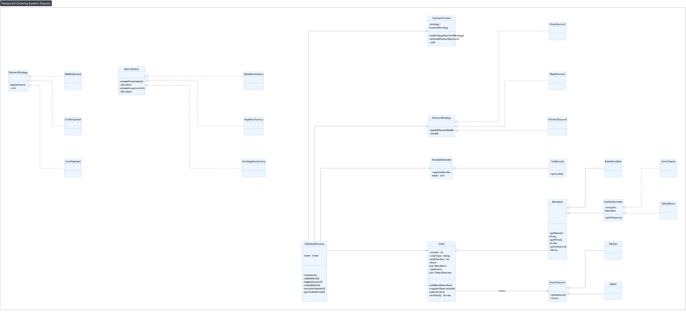

# Restaurant Ordering System

This project is a Java console-based application simulating a Restaurant Ordering System. It is designed primarily to showcase the practical application of several fundamental  Design Patterns to manage core restaurant functions.

---

### Installation and Setup

To run this application, ensure you have the following prerequisites installed on your system:

* Java Development Kit (JDK): Version 8 or higher.
* Project Structure: Make sure all Java files are organized into the corresponding package folders under a root `src` directory.

---

### Project Overview: Design Patterns in Action

This system serves as an excellent demonstration of how design patterns can create a flexible, maintainable, and scalable architecture.

| Package/Feature | Design Pattern Used | Description |
|:----------------| :--- | :--- |
| Menu           | Abstract Factory | Allows for the creation of distinct product lines (e.g., Vegetarian, Non-Vegetarian, and Kids' menus), ensuring menu items are logically grouped and created without exposing the instantiation logic. |
| Order       | Decorator | Permits dynamic and flexible addition of features (like ExtraCheese, RanchSauce, and SpicySauce) to any base menu item without modifying the item's core class. This allows for runtime customization. |
| Discount    | Strategy | Enables easy swapping and combination of discount logic (e.g., percentage off chicken items, fixed percentage off pizzas) without affecting the central checkout logic. The system automatically checks all active discount strategies. |
| Payment     | Strategy | Allows the checkout process to dynamically switch between payment methods (like cash\_pay, credit\_card\_pay, and e\_wallet\_pay) without changing the order handling process. |
| Workflow    | Observer | Implements a publish/subscribe mechanism. When an order is placed (the Order subject), the Kitchen and Waiter (the observers) are instantly notified and take appropriate actions (e.g., preparing the food, serving the table). |

---

### Discount Scenarios 


| Strategy         | Rule | Scenario Items | Base Price for Discount | Calculation | Final Discount |
|:-----------------| :--- | :--- | :--- | :--- | :--- |
| meat_discount    | 15% off all items in the Burger category. | Chicken Burger, Beef Burger | 305.00 EGP | 15% for meat-relevant items and 12% for chicken-relevant items. | - 64.95 EGP |
| chicken_discount | 12% off all items whose name contains "chicken". | Chicken Italian Pizza, Chicken Burger | 320.00 EGP | 10% for pizza-relevant items, 12% for chicken-relevant items, and 15% for meat-relevant items. | - 78.40 EGP |
| pizza_discount   | 10% off all items in the Pizza category. | Italian Veg Pizza, Kids mini Pizza | 237.00 EGP | 10% for each pizza ordered. | - 23.70 EGP |

---

## UML Diagram
### System Class Diagram:


## Sample Test Cases
### Test Case 1: 

```
WELCOME TO OUR RESTAURANT ORDERING SYSTEM 

PLEASE SELECT A MENU CATEGORY
1. Non-Vegetarian
2. Vegetarian
3. Kids Menu
Enter choice: 1

 Non-Veg Menu 
1. Chicken Italian Pizza (160.00 EGP)
2. Sausage American Pizza (130.00 EGP)
3. Beef Burger (145.00 EGP)
4. Chicken Burger (160.00 EGP)
Choose item: 1
Enter Quantity (minimum 1): 1
Add Extra Cheese (+15 EGP) to Chicken Italian Pizza? (y/n): n
Add Spicy Sauce (+8 EGP) to Chicken Italian Pizza? (y/n): n
Add Extra Ranch Sauce (+10 EGP) to Chicken Italian Pizza? (y/n): n
>> Added 1 x Chicken Italian Pizza to order.

Do you want to add another item? (y/n): y

PLEASE SELECT A MENU CATEGORY

1. Non-Vegetarian
2. Vegetarian
3. Kids Menu
Enter choice: 2

Veg Menu
1. Italian Veg Pizza (150.00 EGP)
2. Greek Veg Pizza (130.00 EGP)
3. Mushroom Veg Burger (130.00 EGP)
4. Lentils Veg Burger (115.00 EGP)
Choose item: 1
Enter Quantity (minimum 1): 1
Add Extra Cheese (+15 EGP) to Italian Veg Pizza? (y/n): n
Add Spicy Sauce (+8 EGP) to Italian Veg Pizza? (y/n): n
Add Extra Ranch Sauce (+10 EGP) to Italian Veg Pizza? (y/n): n
>> Added 1 x Italian Veg Pizza to order.

Do you want to add another item? (y/n): n

 ORDER TYPE 
1. Dine-In
2. Takeaway
3. Delivery
Select Order Type: 1
Enter Table Number: 1

PLEASE SELECT PAYMENT METHOD
1. Credit Card
2. Cash
3. Digital Wallet
Select Payment: 1

DISCOUNT
Checking item categories for applicable discounts:
   (Saving: 31.00 EGP) applied to pizza relevant items.
   (Saving: 19.20 EGP) applied to chicken relevant items.

Total Accumulated Discount: 50.20 EGP
Order Subtotal is: 310.00 EGP before taxes and discounts.
Discount Applied: -50.20 EGP
Taxes Calculated (14%): 36.37 EGP
Final Amount is : 296.17 EGP
Your detailed Receipt

 YOUR ORDER RECEIPT 
Order ID: 1
Table:    1
Type:     Dine-In
--------------------------------------
 - Chicken Italian Pizza          : 160.00 EGP
 - Italian Veg Pizza            : 150.00 EGP
---------------------------------------
Subtotal:          310.00 EGP
Discount applied:      -   50.20 EGP
Taxes (14%):         36.37 EGP
--------------------------------------
TOTAL AMOUNT:      296.17 EGP
Processing Payment...
Paid 296.17 EGP using Credit Card.
Finishing Order Placement
Placing order 1 with 2 items
[Kitchen] New order received -> 1, items: Chicken Italian Pizza| Italian Veg Pizza| 
[Waiter] Please serve order -> 1(table: 1)
THANK YOU FOR VISITING OUR RESTAURANT, HOPE U ENJOYED OUR SERVICES
```


### Test Case 2:
```
WELCOME TO OUR RESTAURANT ORDERING SYSTEM 

PLEASE SELECT A MENU CATEGORY

1. Non-Vegetarian
2. Vegetarian
3. Kids Menu
Enter choice: 2

Veg Menu
1. Italian Veg Pizza (150.00 EGP)
2. Greek Veg Pizza (130.00 EGP)
3. Mushroom Veg Burger (130.00 EGP)
4. Lentils Veg Burger (115.00 EGP)
Choose item: 3
Enter Quantity (minimum 1): 1
Add Extra Cheese (+15 EGP) to Mushroom Veg Burger? (y/n): y
\Add Spicy Sauce (+8 EGP) to Mushroom Veg Burger Extra Cheese? (y/n): n
Add Extra Ranch Sauce (+10 EGP) to Mushroom Veg Burger Extra Cheese? (y/n): n
>> Added 1 x Mushroom Veg Burger to order.

Do you want to add another item? (y/n): y

PLEASE SELECT A MENU CATEGORY

1. Non-Vegetarian
2. Vegetarian
3. Kids Menu
Enter choice: 2

Veg Menu
1. Italian Veg Pizza (150.00 EGP)
2. Greek Veg Pizza (130.00 EGP)
3. Mushroom Veg Burger (130.00 EGP)
4. Lentils Veg Burger (115.00 EGP)
Choose item: 1
Enter Quantity (minimum 1): 1
Add Extra Cheese (+15 EGP) to Italian Veg Pizza? (y/n): n
Add Spicy Sauce (+8 EGP) to Italian Veg Pizza? (y/n): n
Add Extra Ranch Sauce (+10 EGP) to Italian Veg Pizza? (y/n): n
>> Added 1 x Italian Veg Pizza to order.

Do you want to add another item? (y/n): n

 ORDER TYPE 
1. Dine-In
2. Takeaway
3. Delivery
Select Order Type: 2

PLEASE SELECT PAYMENT METHOD
1. Credit Card
2. Cash
3. Digital Wallet
Select Payment: 2

DISCOUNT
Checking item categories for applicable discounts:
   (Saving: 15.00 EGP) applied to pizza relevant items.
   (Saving: 21.75 EGP) applied to meat relevant items.

Total Accumulated Discount: 36.75 EGP
Order Subtotal is: 295.00 EGP before taxes and discounts.
Discount Applied: -36.75 EGP
Taxes Calculated (14%): 36.16 EGP
Final Amount is : 294.41 EGP
Your detailed Receipt

 YOUR ORDER RECEIPT 
Order ID: 1
Table:    N/A
Type:     Takeaway
--------------------------------------
 - Mushroom Veg Burger Extra Cheese : 145.00 EGP
 - Italian Veg Pizza            : 150.00 EGP
---------------------------------------
Subtotal:          295.00 EGP
Discount applied:      -   36.75 EGP
Taxes (14%):         36.16 EGP
--------------------------------------
TOTAL AMOUNT:      294.41 EGP
Processing Payment...
Paid 294.41 EGP using Cash.
Finishing Order Placement
Placing order 1 with 2 items
[Kitchen] New order received -> 1, items: Mushroom Veg Burger Extra Cheese| Italian Veg Pizza| 
THANK YOU FOR VISITING OUR RESTAURANT, HOPE U ENJOYED OUR SERVICES
```

### Test Case 3:
```
WELCOME TO OUR RESTAURANT ORDERING SYSTEM 

PLEASE SELECT A MENU CATEGORY

1. Non-Vegetarian
2. Vegetarian
3. Kids Menu
Enter choice: 3

Kids Menu
1. Kids mini Pizza (87.00 EGP)
2. Kids Burger (62.00 EGP)
Choose item: 1
Enter Quantity (minimum 1): 1
Add Extra Cheese (+15 EGP) to Kids mini Pizza? (y/n): n
Add Spicy Sauce (+8 EGP) to Kids mini Pizza? (y/n): n
Add Extra Ranch Sauce (+10 EGP) to Kids mini Pizza? (y/n): n
>> Added 1 x Kids mini Pizza to order.

Do you want to add another item? (y/n): y

PLEASE SELECT A MENU CATEGORY

1. Non-Vegetarian
2. Vegetarian
3. Kids Menu
Enter choice: 3

Kids Menu
1. Kids mini Pizza (87.00 EGP)
2. Kids Burger (62.00 EGP)
Choose item: 2
Enter Quantity (minimum 1): 1
Add Extra Cheese (+15 EGP) to Kids Burger? (y/n): n
Add Spicy Sauce (+8 EGP) to Kids Burger? (y/n): n
Add Extra Ranch Sauce (+10 EGP) to Kids Burger? (y/n): n
>> Added 1 x Kids Burger to order.

Do you want to add another item? (y/n): y

PLEASE SELECT A MENU CATEGORY

1. Non-Vegetarian
2. Vegetarian
3. Kids Menu
Enter choice: 1

 Non-Veg Menu 
1. Chicken Italian Pizza (160.00 EGP)
2. Sausage American Pizza (130.00 EGP)
3. Beef Burger (145.00 EGP)
4. Chicken Burger (160.00 EGP)
Choose item: 1
Enter Quantity (minimum 1): 1
Add Extra Cheese (+15 EGP) to Chicken Italian Pizza? (y/n): n
Add Spicy Sauce (+8 EGP) to Chicken Italian Pizza? (y/n): n
Add Extra Ranch Sauce (+10 EGP) to Chicken Italian Pizza? (y/n): n
>> Added 1 x Chicken Italian Pizza to order.

Do you want to add another item? (y/n): n

 ORDER TYPE 
1. Dine-In
2. Takeaway
3. Delivery
Select Order Type: 3
Enter Delivery Address: almoneeb

PLEASE SELECT PAYMENT METHOD
1. Credit Card
2. Cash
3. Digital Wallet
Select Payment: 3

DISCOUNT
Checking item categories for applicable discounts:
   (Saving: 24.70 EGP) applied to pizza relevant items.
   (Saving: 9.30 EGP) applied to meat relevant items.
   (Saving: 19.20 EGP) applied to chicken relevant items.

Total Accumulated Discount: 53.20 EGP
Order Subtotal is: 309.00 EGP before taxes and discounts.
Discount Applied: -53.20 EGP
Taxes Calculated (14%): 35.81 EGP
Final Amount is : 291.61 EGP
Your detailed Receipt

 YOUR ORDER RECEIPT 
Order ID: 1
Table:    N/A
Type:     Delivery
Deliver To: almoneeb
--------------------------------------
 - Kids mini Pizza                :  87.00 EGP
 - Kids Burger                  :  62.00 EGP
 - Chicken Italian Pizza          : 160.00 EGP
---------------------------------------
Subtotal:          309.00 EGP
Discount applied:      -   53.20 EGP
Taxes (14%):         35.81 EGP
--------------------------------------
TOTAL AMOUNT:      291.61 EGP
Processing Payment...
Paid 291.61 EGP using Digital Wallet.
Finishing Order Placement
Placing order 1 with 3 items
[Kitchen] New order received -> 1, items: Kids mini Pizza| Kids Burger| Chicken Italian Pizza| 
THANK YOU FOR VISITING OUR RESTAURANT, HOPE U ENJOYED OUR SERVICES
```